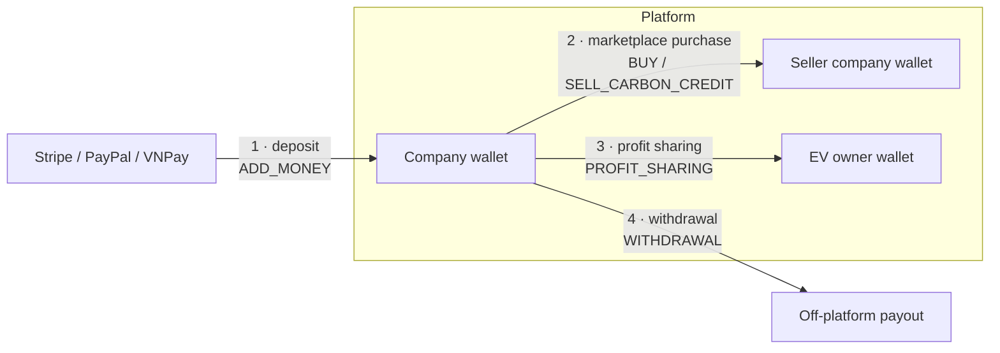
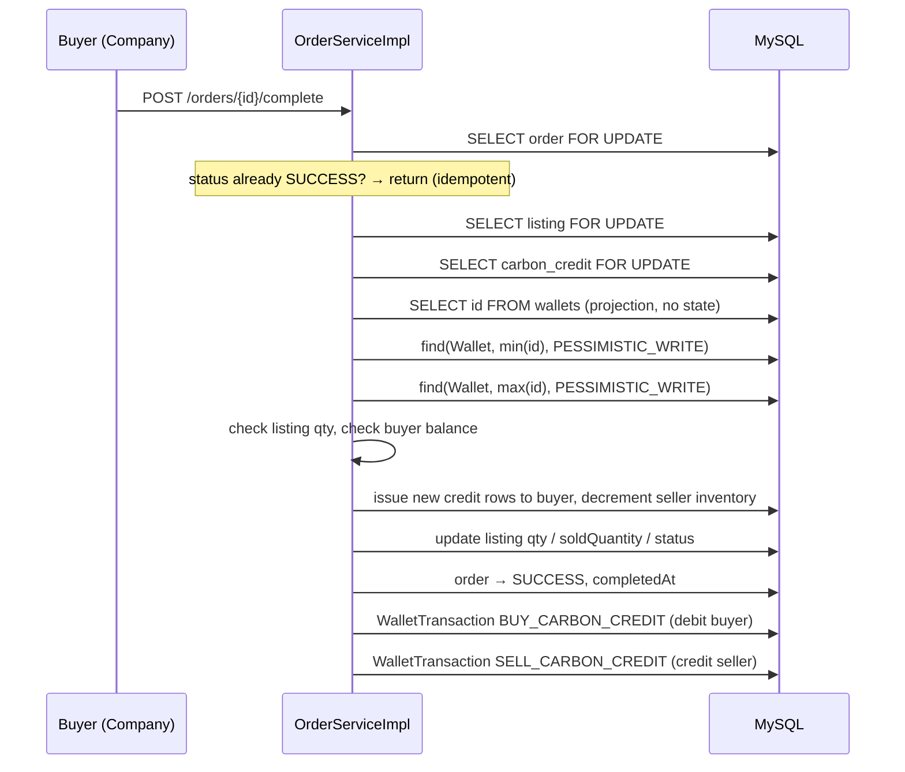

# CarbonX — Carbon Credit Marketplace

A carbon-credit exchange where EV owners earn credits from verified driving data, companies buy and
retire those credits, and a third-party verifier (CVA) signs off on the emission reports that create
them. Every one of those steps moves money or credits between wallets, so the backend is built
around a single idea: **no balance changes without an immutable ledger row that records the balance
before and after.**

Spring Boot 3.3 / Java 17 / MySQL 8 / Redis · React 18 + Vite · Docker Compose + Nginx

<p align="left">
  
  
  
  
  
</p>

---

## 1. Actors and what each one can move

| Actor | Owns | Can move |
|---|---|---|
| **EV Owner** | a wallet (cash + credit balance), vehicles | receives profit-sharing payouts |
| **Company** | a wallet, credit inventory, marketplace listings | buys/sells credits, retires credits, pays out to EV owners |
| **CVA** (verifier) | nothing financial | approves emission reports → unlocks credit issuance |
| **Admin** | — | approves withdrawals, oversees users and finance |

Two independent balances live on the same `wallets` row:

- `balance` — cash, `DECIMAL(18,2)`
- `carbon_credit_balance` — credits, `DECIMAL(18,4)`

Both are only ever mutated together with a `WalletTransaction` insert (see §3).

---

## 2. The four money flows

Everything financial in this system is one of four flows. All four converge on `WalletTransaction`.



### Flow 1 — Deposit (gateway → wallet)

`POST /api/v1/payment` creates a `PaymentOrder(PENDING)` and returns a gateway checkout URL. The
provider's own reference (the Stripe session id, the PayPal payment id, the VNPay `vnp_TxnRef`) is
stored on the order **server-side at creation time** — the browser only ever receives the URL.

After the user pays, the return URL calls `POST /api/v1/wallet/deposit?order_id`, which runs in two
deliberate steps:

1. `assertDepositVerifiable(orderId)` — outside any transaction. Checks the order belongs to the
   caller, then asks the provider whether that reference is actually paid, for the expected amount
   (`verifyStripePaid` / `verifyPaypalApproved`). Throws if not.
2. `applyVerifiedDeposit(orderId)` — one transaction. Locks the order row, transitions
   `PENDING → SUCCEEDED`, and credits the wallet through
   `WalletTransactionService.createTransaction(ADD_MONEY)`.

The split is the point: **the backend establishes that payment happened, the frontend never asserts
it.** A replayed or concurrent return URL credits exactly once, because the state transition happens
under the row lock and only from `PENDING`. Landing on the success page without paying credits
nothing, because step 1 asks the provider rather than trusting the redirect.

### Flow 2 — Marketplace purchase (buyer wallet → seller wallet)

`POST /api/v1/orders` creates an `Order(PENDING)` after checking listing availability, quantity, and
that the buyer is not the seller. Quantities must be whole numbers — one credit is one indivisible
unit, so a fractional order is rejected at creation instead of failing late during issuance.

Settlement is a separate, explicit step — `POST /api/v1/orders/{id}/complete`:



Every row settlement touches is locked with `PESSIMISTIC_WRITE` before it is read: the order row
itself (so the `SUCCESS` idempotency check runs *under* the lock), the listing, the seller's
`CarbonCredit` inventory, and both wallets. Two buyers racing for the last credit serialise instead
of overselling; a replayed `complete` call settles once.

Three details in that ordering were learned the hard way, from ITs against a real MySQL rather than
from mocks — see [§7](#7-what-the-concurrency-tests-caught):

- the locking finders deliberately **do not** fetch-join, so `FOR UPDATE` is part of the same
  statement;
- wallets are located by an **id projection first**, then loaded under the lock, so the lock is the
  first touch of the entity in the transaction;
- both wallets are locked in **ascending id order**, so two opposite trades between the same pair of
  companies cannot deadlock.

On failure the transaction rolls back and the `ERROR` status is written afterwards, from the
controller's catch, by `OrderStatusRecorder` in its own `REQUIRES_NEW` transaction — writing it
inside would try to update the very row the rolled-back transaction still has locked.

### Flow 3 — Profit sharing (company wallet → many EV owner wallets)

Triggered by `POST /api/v1/profit-sharing/share` once a CVA has verified the emission reports.
`ProfitSharingServiceImpl` computes, per EV owner, the energy they contributed → credits (emission
factor 0.6) → cash payout, then pays each owner in **its own `REQUIRES_NEW` transaction**:

- One owner's failure (missing wallet, insufficient company balance) is recorded as a
  `ProfitDistributionDetail(FAILED)` with the error message and does **not** roll back the owners
  already paid.
- If at least one owner failed, the distribution is marked `FAILED` and the emission report stays
  `CREDIT_ISSUED`. It is **not** marked `PAID_OUT`: doing so would claim everyone was paid and remove
  the retry path. Call `POST /api/v1/profit-sharing/distributions/{id}/retry` to pay only the
  remaining `FAILED` details; owners already `SUCCESS` are never paid twice.
- The transfer itself goes through `WalletService.transferFunds`, which locks *both* wallets with
  `PESSIMISTIC_WRITE` before reading either balance — the classic two-account transfer, with the
  debit and the credit written as two linked `WalletTransaction` rows (negative and positive amount)
  pointing at the same `ProfitDistribution`.
- Email failures are caught and logged; they never roll back a completed transfer.

### Flow 4 — Withdrawal (wallet → off-platform, admin-gated)

`POST /api/v1/withdrawal/{amount}` checks the balance and creates a `Withdrawal(PENDING)`. An admin
then calls `PATCH /api/v1/withdrawal/admin/{id}/process/{accept}` — an `ADMIN`-only endpoint.

That handler locks the withdrawal row and refuses any status other than `PENDING`, so an admin
double-click cannot process the same request twice. On rejection the refund goes through
`createTransaction(WITHDRAWAL_REFUND)` rather than a bare `setBalance`, so the money movement lands
in the ledger like every other one. Both outcomes notify the user by email and over SSE.

---

## 3. The ledger: why `balanceBefore` / `balanceAfter`

`WalletTransaction` is append-only and stores, on every row:

| Column | Why it exists |
|---|---|
| `amount` | the delta (negative for debits in `transferFunds`) |
| `balance_before`, `balance_after` | the wallet's balance immediately either side of *this* row |
| `transaction_type` | `ADD_MONEY`, `BUY_CARBON_CREDIT`, `SELL_CARBON_CREDIT`, `PROFIT_SHARING`, `WITHDRAWAL`, `ISSUE_CREDIT`, `RETIRE_CREDIT`, … |
| `order_id`, `payment_order_id`, `credit_batch_id`, `distribution_id` | the business event that caused it — every row traces back to something |
| `created_at` | `@CreationTimestamp`, never set by hand |

Storing the two balances is redundant with `SUM(amount)` — and that redundancy **is the point**:

1. **Reconciliation without replay.** `wallet.balance` can be checked against the newest row's
   `balance_after` in one query. If they disagree, something wrote a balance outside the ledger, and
   you know it immediately instead of during an audit.
2. **The chain localises gaps.** The intent is that each row's `balance_before` continues the previous
   row's `balance_after`, so a break in that chain points at a specific pair of transactions instead
   of leaving you to diff a whole wallet.
3. **Statements stay correct after policy changes.** A statement line shows the balance the user
   actually had at that moment, not one recomputed under today's rules.

This is the standard trade in banking ledgers: give up normalisation to get an audit trail you can
check with a query. The cost is that the two columns must be written by the *same* code that mutates
the balance — which is why `WalletTransactionServiceImpl.createTransaction` and
`WalletServiceImpl.transferFunds` are the only two places allowed to do it.

Credit movements use the same mechanism against `carbon_credit_balance` (`ISSUE_CREDIT` on issuance,
`RETIRE_CREDIT` on retirement), so the credit side is auditable the same way the cash side is.

---

## 4. Why SSE for notifications

Users need to hear about events they did not trigger: a deposit clearing, an order settling, a
withdrawal being approved, a payout landing. Three options:

| | Polling | WebSocket | **SSE** |
|---|---|---|---|
| Direction needed | — | bidirectional | **server → client only** ✔ |
| Latency | poll interval | instant | instant |
| Infra cost | N clients × interval requests | new protocol, upgrade path through Nginx | plain HTTP/1.1 `text/event-stream` |
| Auth | existing JWT filter | needs a separate handshake auth path | **existing JWT filter, unchanged** ✔ |
| Reconnect | n/a | hand-rolled | built into `EventSource` |

Every notification in this system is one-directional — the client never pushes anything back over the
channel, it uses normal REST for that. Paying for WebSocket's bidirectionality would mean a second
authentication path and a proxy upgrade config for capability we don't use. SSE rides the existing
`Authorization` header through the same Spring Security filter chain.

Implementation (`SseServiceImpl`): `GET /api/v1/notifications` returns an `SseEmitter` with a 30-minute
timeout, held in a `ConcurrentHashMap<Long, SseEmitter>` keyed by user id. `onCompletion` /
`onTimeout` / `onError` all remove the entry, and a new subscription for the same user completes the
previous emitter so a reconnect cannot leak the old one.

The registry is per-JVM, which fits the current single-instance deployment. Scaling out horizontally
would move it behind Redis pub/sub so any node can reach any connected user.

---

## 5. Architecture

```
Controller  ──►  Service (interface)  ──►  ServiceImpl  ──►  Repository (Spring Data JPA)
    │                                           │
    │ ApiRequest<T> / ApiResponse<T>             │ @Transactional boundary lives here
    │ (utils/common)                             │ pessimistic locks declared on repo methods
    ▼
GlobalExceptionHandler (@ControllerAdvice)
```

Package layout under `com.carbonx.marketcarbon`:

| Package | Contents |
|---|---|
| `controller/` | REST endpoints, one per aggregate; no business logic |
| `service/` + `service/impl/` | interface + implementation; **transaction boundaries** |
| `repository/` | Spring Data JPA, including explicit `@Lock(PESSIMISTIC_WRITE)` finders |
| `model/` | JPA entities |
| `dto/request`, `dto/response` | wire types, never entities |
| `mapper/` | MapStruct entity ↔ DTO |
| `utils/common/` | `ApiRequest<T>`, `ApiResponse<T>`, `ResponseStatus` — the API envelope |
| `exception/` | `AppException` + `ErrorCode` enum + `GlobalExceptionHandler` |
| `helper/notification/`, `scheduler/`, `config/` | email templating, cron jobs, security/Redis/S3 config |

### API envelope

Every request and response is wrapped, so a trace id survives the whole round trip:

```jsonc
// request
{ "requestTrace": "uuid", "requestDateTime": "2026-08-20T09:00:00Z", "data": { /* payload */ } }

// response
{ "requestTrace": "uuid", "requestDateTime": "...",
  "responseStatus": { "responseCode": "200", "responseMessage": "SUCCESS" },
  "response": { /* payload */ } }
```

`ApiRequest` accepts `requestParameters` / `requestParamters` as `@JsonAlias` for `data` — legacy
clients from before the field was renamed. Callers may supply `X-Request-Trace` and
`X-Request-DateTime` headers; controllers generate a UUID when they don't.

### Security

JWT access/refresh via `jjwt`, Google OAuth2 login, email OTP verification, role-based access
(`ADMIN` / `COMPANY` / `EV_OWNER` / `CVA`), and a token-bucket rate limiter
(`app.rate-limit.capacity=20` per minute).

Registration stores the new account and OTP in one transaction: if the synchronous OTP email
fails, the pending account is rolled back, so the user can register again instead of being stuck
behind `EMAIL_EXISTED`. A pending account can also request a fresh registration code with
`POST /api/v1/auth/register/resend-otp` (same 60-second resend guard as forgot-password).

The filter chain is **deny-by-default**: a route nobody remembered to map requires authentication
rather than falling through to public. Self-registration can only create `EV_OWNER` or `COMPANY` — a
client cannot ask for `ADMIN` or `CVA` in the signup payload. The JWT signing secret comes from
`JWT_SECRET`; the `prod` profile has no fallback and refuses to start without it. Error responses
carry a code and a safe message, never an internal exception string.

---

## 6. Running locally

Secrets are never committed. `docker-compose.yml` reads them from a git-ignored `.env` and fails
fast with a named error if one is missing, so start there:

```bash
cp .env.example .env      # then fill in MYSQL_ROOT_PASSWORD, SPRING_MAIL_*, JWT_SECRET
docker compose up --build -d
# MySQL      localhost:3307   (db core_ccm)
# backend    localhost:8082
# frontend   localhost:3000
```

**Backend on the host, MySQL in Docker:**

```bash
docker compose up -d db
cd backend/Market_carbon
export SPRING_PROFILES_ACTIVE=local
./mvnw spring-boot:run
```

`application.properties` is `${VAR}` placeholders throughout. The minimum to boot:

```bash
SPRING_DATASOURCE_URL=jdbc:mysql://localhost:3307/core_ccm?useSSL=false&allowPublicKeyRetrieval=true&serverTimezone=UTC
SPRING_DATASOURCE_USERNAME=root
SPRING_DATASOURCE_PASSWORD=...
SPRING_DATASOURCE_DRIVER_CLASS_NAME=com.mysql.cj.jdbc.Driver
SERVER_PORT=8082
JWT_SECRET=...                 # dev falls back to an insecure literal; prod refuses to start
SPRING_MAIL_HOST=smtp.gmail.com
SPRING_MAIL_PORT=587
SPRING_MAIL_USERNAME=...
SPRING_MAIL_PASSWORD=...
SPRING_MAIL_PROPERTIES_MAIL_SMTP_AUTH=true
SPRING_MAIL_PROPERTIES_MAIL_SMTP_STARTTLS_ENABLE=true
```

Production additionally requires `PAYPAL_MODE` (no fallback in the base profile — set it to
`sandbox` or `live`) together with `PAYPAL_CLIENT_ID` / `PAYPAL_CLIENT_SECRET`. The application
refuses to start if the mode is missing or invalid instead of silently using sandbox.

Those placeholders have **no default**, so the bean that injects them fails the startup when
they are missing — they are required, not optional:

| Variable | Needed by |
| --- | --- |
| `STRIPE_API_KEY` | `PaymentServiceImpl`, `PaymentVerificationService` (Stripe checkout/verification) |
| `AWS_S3_BUCKET`, `AWS_ACCESS_KEY_ID`, `AWS_SECRET_ACCESS_KEY`, `AWS_S3_REGION` | `S3Config`, `S3StorageServiceImpl` (S3 upload) |
| `AWS_S3_PUBLIC_BASE_URL` | public URL prefix for uploaded files |
| `AI_GEMINI_API_KEY`, `AI_GEMINI_MODEL` | Gemini AI scoring/chat (only when the AI feature is enabled) |
| `APP_CORS_ALLOWED_ORIGINS` | comma-separated browser origins; the default list only covers the usual local dev ports |
| `APP_FRONTEND_BASE_URL` | where the OAuth2 login redirects the browser |

Set them to dummy values locally if the corresponding integration is not used — the application
starts with them set to a placeholder, it just cannot call the provider.

In development `spring.jpa.hibernate.ddl-auto` defaults to `update`, so the first boot against an
empty `core_ccm` database creates the tables. The `prod` profile defaults to `validate`.

- **Fresh database:** run `backend/database/core_ccm.sql` only. It contains the schema the JPA
  entities map, including `profit_distribution.emission_report_id`,
  `profit_distribution.claim_token`, the `credit_serial_counters` table and the upload/AI
  columns of `emission_reports`, plus their indexes/FKs. Do **not** re-run the incremental
  migrations on top of a fresh schema.
- **Existing database:** apply every script under `backend/database/migrations/` **before**
  starting the production build. The scripts are idempotent; the
  `2026-10-20_add_emission_report_to_profit_distribution.sql` migration adds the payout link only
  if it is missing and backfills it only when there is exactly one unambiguous report candidate.
  `2026-10-20_add_claim_token_to_profit_distribution.sql` adds the per-run lease token and
  `2026-10-20_sync_schema_with_entities.sql` adds every column/table the entities map but the
  live schema was missing (`prod` runs `ddl-auto=validate` and refuses to start otherwise).

Legacy distributions whose `emission_report_id` remains `NULL` can still be retried: their
`PENDING`/`FAILED` owners are paid, but the emission report status cannot be updated
automatically. Reconcile/link those rows manually before treating the report as paid out. Such a
distribution is only considered superseded by another **legacy** distribution of the same
company + project; a payout for a different report no longer blocks it forever. Because a legacy
row does not say which report it paid, owners already paid by another distribution of the same
company + project are marked `SKIPPED` instead of being paid twice.
Legacy distributions already marked `COMPLETED` while an owner detail is still `PENDING`/`FAILED`
(the old code completed distributions unconditionally) are retryable too: `/retry` pays only the
unsettled owners and leaves an already `PAID_OUT` report alone. A distribution without any owner
detail is rejected with a clear error — there is nothing to retry.

A `PROCESSING` distribution left behind by a crash becomes retryable after
`profit-sharing.stale-processing-minutes` (default `15`) without a progress heartbeat. Every
claim writes a UUID `claim_token`; `/share` and `/retry` refresh `updated_at` before each owner,
and status transitions (`COMPLETED`/`FAILED`) only apply while the worker still holds that token.
An owner row is locked with `PESSIMISTIC_WRITE` for the duration of its payout transaction, so a
reclaimed worker cannot pay the same owner twice.

`DataInitializer` then seeds the roles and the three demo accounts. Their credentials are
overridable — `carbonx.seed.admin-email` / `-password`, and the same pair for `company-` and `cva-`.
Left unset, they fall back to the development defaults and the app logs a warning naming each
account still using one.

**Frontend:**

```bash
cd frontend && npm install && npm run dev
```

**Tests:**

```bash
cd backend/Market_carbon && ./mvnw test    # 93 unit tests, no infrastructure needed

# the concurrency ITs spin up a real MySQL, so they need Docker and are not part
# of `mvnw test` (surefire only picks up *Test); run one explicitly:
cd backend/Market_carbon && ./mvnw test -Dtest=OrderSettlementConcurrencyIT
```

---

## 7. What the concurrency tests caught

The money-movement paths are covered twice: fast unit tests against mocks, and integration tests that
run the real settlement against a real MySQL in a Testcontainer. The second kind exists because the
first kind cannot see the two bugs below — a mocked repository has no lock semantics and no
persistence context, so both paths looked correct and both were wrong.

**Hibernate follow-on locking.** The original finder combined a fetch-join with `@Lock`, which reads
naturally enough:

```java
@Lock(LockModeType.PESSIMISTIC_WRITE)
@Query("select o from Order o join fetch o.company where o.id = :id")
Optional<Order> findByIdWithPessimisticLockAndDetails(Long id);
```

Hibernate cannot append `FOR UPDATE` to a query with a join fetch, so it issues the `SELECT`
**unlocked** and locks the rows in a second statement afterwards. Two concurrent
`completeOrder(orderId)` calls both read `PENDING` in that unlocked window and both settled the same
order — double debit, double credit, double issuance.

Settlement now uses the plain `findByIdWithPessimisticLock` variants, where `FOR UPDATE` is part of
the same statement, and lets the associations load lazily afterwards once the row is already locked.
The fetch-join variants are still declared — and `OrderSettlementConcurrencyTest` asserts with
Mockito `never()` that the settlement path does not call them, so the trap cannot quietly come back.

**A stale entity beats a correct lock.** Loading a wallet unlocked and *then* calling
`entityManager.find(Wallet.class, id, PESSIMISTIC_WRITE)` acquires the database lock but returns the
instance already cached in the persistence context — the stale one. Both threads computed
`balanceBefore = 200` from that cached copy and wrote conflicting `balanceAfter` values: a textbook
lost update, with a correctly-locked row. The fix is to project only the wallet **id** first, so that
`find(..., PESSIMISTIC_WRITE)` is the first touch of the entity in the transaction and therefore
reads the newest committed state.

Both are visible in `OrderSettlementConcurrencyIT`. Neither was visible in
`OrderSettlementConcurrencyTest`, which passed throughout.

A written audit of the codebase — current architecture, technical debt, target design, and the
security findings behind the `fix(security)` commits — lives in
[`docs/architecture/`](docs/architecture/).

---

## Demo accounts

| Role | URL | Email | Password |
|---|---|---|---|
| Admin | https://carbonx.io.vn/admin/carbonX/mkp/login | admin1@gmail.com | `Tuong2005@` |
| Company | https://carbonx.io.vn/login | company@example.com | `Password@1` |
| CVA | https://carbonx.io.vn/cva/carbonX/mkp/login | cva@example.com | `Password@1` |

> Demo data is reset periodically; these accounts are for evaluation only.

Full functional documentation:
[Google Drive](https://drive.google.com/drive/u/1/folders/1V0FyoZw_b9KMyj4aiCg9Z2sy7t4khyE-)

---

## Team — AQHighTeam

| Student ID | Name | GitHub |
|---|---|---|
| SE196732 | Nguyễn Gia Khiêm | https://github.com/giakhiem20051710 |
| SE196853 | Lê Huy Tường | https://github.com/LeHuyTuong |
| SE196587 | Phan Bảo Tín | https://github.com/linh20051708 |
| SE193952 | Phạm Thị Diệu Linh | https://github.com/PhanBaoTin |

Academic submission; external contributions are not accepted.
