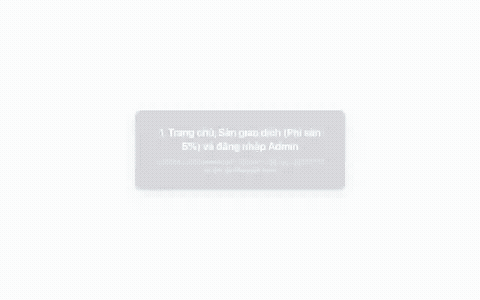
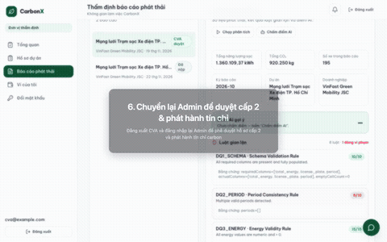
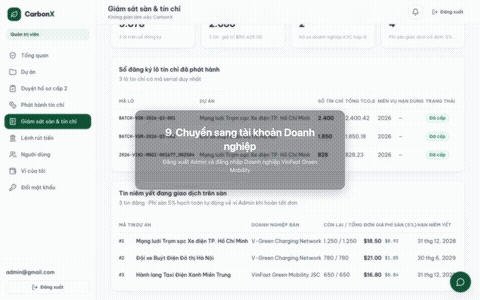
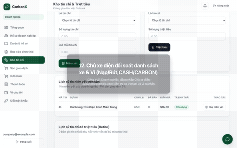

# CarbonX — Carbon Credit Marketplace

Sàn giao dịch tín chỉ carbon: chủ xe điện tạo ra dữ liệu giảm phát thải, doanh nghiệp gom dữ liệu đó thành dự án, đơn vị thẩm định (CVA) và Admin duyệt, tín chỉ được phát hành, bán trên sàn và doanh thu được chia lại cho từng chủ xe.

Nguyên tắc cốt lõi của backend: **mọi thay đổi số dư ví đều đi kèm một dòng `WalletTransaction` bất biến ghi số dư trước và sau.**

Spring Boot 3.3 / Java 17 / MySQL 8 · React 19 + Vite 6 + Tailwind 4 + TypeScript · Docker Compose

---

## Vai trò

| Vai trò | Làm gì |
|---|---|
| **Chủ xe điện (EV Owner)** | Đăng ký KYC và xe, nhận tiền chia sẻ doanh thu vào ví, xem tiền thuộc lô tín chỉ nào |
| **Doanh nghiệp (Company)** | Đăng ký dự án, nộp báo cáo phát thải, giữ kho tín chỉ, đăng bán/mua, chia doanh thu cho chủ xe |
| **CVA** | Thẩm định hồ sơ dự án và báo cáo phát thải (không có ví tiền) |
| **Admin** | Tạo dự án, duyệt hồ sơ cấp 2, phát hành tín chỉ, duyệt rút tiền, quản lý người dùng và xe |

## Luồng nghiệp vụ chính

1. Admin tạo dự án → Doanh nghiệp đăng ký tham gia → CVA thẩm định → Admin duyệt.
2. Doanh nghiệp nộp báo cáo phát thải (dữ liệu của các chủ xe) → CVA thẩm định → Admin duyệt.
3. Admin phát hành lô tín chỉ (công thức VM0038, mỗi lô có mã lô và dải serial; lô đã phát hành không đổi khi quy tắc dự án thay đổi sau này).
4. Doanh nghiệp đăng bán trên sàn, doanh nghiệp khác mua và thanh toán bằng ví.
5. Doanh nghiệp chia doanh thu: tiền chuyển vào ví từng chủ xe theo kWh sạc thực tế, kèm bảng chi tiết từng người.
6. Chủ xe rút tiền, Admin duyệt lệnh rút.

## Kiến trúc

```
frontend/                  React SPA (Vite, Tailwind, React Query, Zustand)
  src/app                  router, layout theo vai trò
  src/pages                màn hình theo vai trò (admin / company / cva / ev)
  src/features             hooks + component theo nghiệp vụ (wallet, payouts, marketplace…)
  src/shared               API client, guard phân quyền, store, tiện ích
backend/Market_carbon/     Spring Boot API (controller → service → repository)
docker-compose.yml         MySQL + backend + frontend (Nginx)
docs/                      kiến trúc, audit, sơ đồ UML
```

- Xác thực JWT, phân quyền theo vai trò ở cả backend (403) lẫn frontend (`RoleGuard`).
- Thông báo thời gian thực qua SSE; thanh toán nạp tiền qua Stripe / PayPal / VNPay.
- Chống thao tác trùng bằng khoá bi quan (`FOR UPDATE`) khi chốt đơn; có test đồng thời với MySQL thật (Testcontainers).

## Video demo

Mỗi luồng có bản xem trước tự chạy (GIF) và file video đầy đủ (MP4) khi bấm vào:

<table><tr><td align="center"><a href="docs/demo/flow01_admin_khoi-tao-du-an.mp4"><br>▶ 1. Admin khởi tạo dự án</a></td><td align="center"><a href="docs/demo/flow02_cva_tham-dinh-ho-so-va-bao-cao.mp4"><br>▶ 2. CVA thẩm định hồ sơ và báo cáo</a></td><td align="center"><a href="docs/demo/flow03_admin_phe-duyet-va-phat-hanh-tin-chi.mp4"><br>▶ 3. Admin phê duyệt và phát hành tín chỉ</a></td></tr><tr><td align="center"><a href="docs/demo/flow04_doanh-nghiep_giao-dich-san-va-thanh-toan.mp4"><br>▶ 4. Doanh nghiệp giao dịch trên sàn</a></td><td align="center"><a href="docs/demo/flow05_doanh-nghiep_chia-se-doanh-thu-profit-sharing.mp4"><br>▶ 5. Chia sẻ doanh thu cho chủ xe</a></td><td align="center"><a href="docs/demo/flow06_chu-xe-dien_quan-ly-xe-va-vi.mp4"><br>▶ 6. Chủ xe quản lý xe và ví</a></td></tr></table>

Toàn bộ file nằm ở [`docs/demo/`](docs/demo/).

## Đa luồng & Chống tranh chấp (Concurrency)

Hệ thống xử lý đồng thời ở 2 điểm nóng tài chính:

1. **Chốt đơn mua tín chỉ (`OrderServiceImpl`)**: Khi nhiều request cùng gọi chốt một đơn hàng, transaction khoá bi quan (`PESSIMISTIC_WRITE` / `SELECT ... FOR UPDATE`) trên đơn hàng, tin đăng và ví người mua/bán, kết hợp kiểm tra trạng thái idempotent — đảm bảo chỉ trừ tiền đúng 1 lần và ghi đúng 1 bộ `WalletTransaction`.
2. **Chia sẻ doanh thu bất đồng bộ (`ProfitSharingServiceImpl` + `ConcurrencyConfig`)**: Khoá dòng `EmissionReport` (`findByIdForUpdate`) để tuần tự hoá lệnh chia tiền, sau đó đẩy việc chuyển khoản từng chủ xe vào thread pool giới hạn (`profitPool`), tách transaction độc lập cho từng chủ xe và dùng `claim_token` + heartbeat để retry không trả trùng.

**Chạy thử đa luồng trực tiếp (8 luồng bắn đồng thời vào 1 đơn hàng):**

```bash
python3 scripts/demo_concurrency.py
```

Kết quả mẫu khi 8 thread cùng qua `Barrier` gọi `POST /api/v1/orders/{id}/complete`:

```text
[Before] Buyer wallet balance = $248295.5
[Order ] Created order #17 (1 credit @ listing #10), launching 8 concurrent threads...

  Thread #01 -> HTTP 200 [OK  ] (  43.5 ms) : Success
  ...
  Thread #08 -> HTTP 200 [OK  ] (  36.4 ms) : Success

[After ] Buyer wallet balance = $248276.0 (debited: $19.5)
[Result] 8/8 threads returned HTTP 200 (1 settled + 7 idempotent no-op under PESSIMISTIC_WRITE); debited $19.5 == 1x order.
```

Integration test đa luồng trên MySQL 8 thật (Testcontainers):

```bash
cd backend/Market_carbon && ./mvnw verify -Dit.test=OrderSettlementConcurrencyIT
```

## Chạy local

**Cách nhanh — Docker Compose**

```bash
cp .env.example .env     # điền MYSQL_ROOT_PASSWORD, SPRING_MAIL_*, JWT_SECRET, STRIPE/PAYPAL
docker compose up --build -d
# MySQL :3307 · Backend :8082 · Frontend :3000
```

**Chạy riêng từng phần**

```bash
# Backend (cần MySQL, ví dụ: docker compose up -d db)
cd backend/Market_carbon
SPRING_PROFILES_ACTIVE=local ./mvnw spring-boot:run     # http://localhost:8082

# Frontend (proxy /api sang :8082)
cd frontend
npm install
npm run dev                                              # http://localhost:5173
# Nạp thêm dữ liệu mẫu phong phú (24 tài khoản, 24 xe điện, 11 tin đăng, 10 báo cáo)
python3 scripts/seed_demo_rich.py
```

Biến môi trường backend tối thiểu: `SPRING_DATASOURCE_URL/USERNAME/PASSWORD`, `JWT_SECRET`, `SPRING_MAIL_*`. Danh sách đầy đủ xem `.env.example` và `application.properties`. Không commit giá trị thật.

## Tài khoản demo (chỉ dữ liệu seed local)

Mật khẩu mặc định của seed: `Password@1` (cấu hình đổi qua `carbonx.seed.*-password`).

| Vai trò | Email |
|---|---|
| Admin | `admin@gmail.com` |
| Doanh nghiệp | `company@example.com` |
| CVA | `cva@example.com` |
| Chủ xe điện | `evowner@example.com` |

Trang đăng nhập có 4 nút **Đăng nhập nhanh** cho các tài khoản này.

## Kiểm thử

```bash
cd frontend && npm test && npm run build          # Vitest + typecheck + build
cd backend/Market_carbon && ./mvnw test           # unit test
cd backend/Market_carbon && ./mvnw verify         # thêm integration test (cần Docker)
```

## Tài liệu

- Kiến trúc, nợ kỹ thuật, phát hiện bảo mật: [`docs/architecture/`](docs/architecture/)
- Tài liệu chức năng: [Google Drive](https://drive.google.com/drive/u/1/folders/1V0FyoZw_b9KMyj4aiCg9Z2sy7t4khyE-)

## Nhóm — AQHighTeam

| MSSV | Họ tên | GitHub |
|---|---|---|
| SE196732 | Nguyễn Gia Khiêm | https://github.com/giakhiem20051710 |
| SE196853 | Lê Huy Tường | https://github.com/LeHuyTuong |
| SE196587 | Phan Bảo Tín | https://github.com/linh20051708 |
| SE193952 | Phạm Thị Diệu Linh | https://github.com/PhanBaoTin |

Bài nộp học thuật; không nhận đóng góp bên ngoài.
